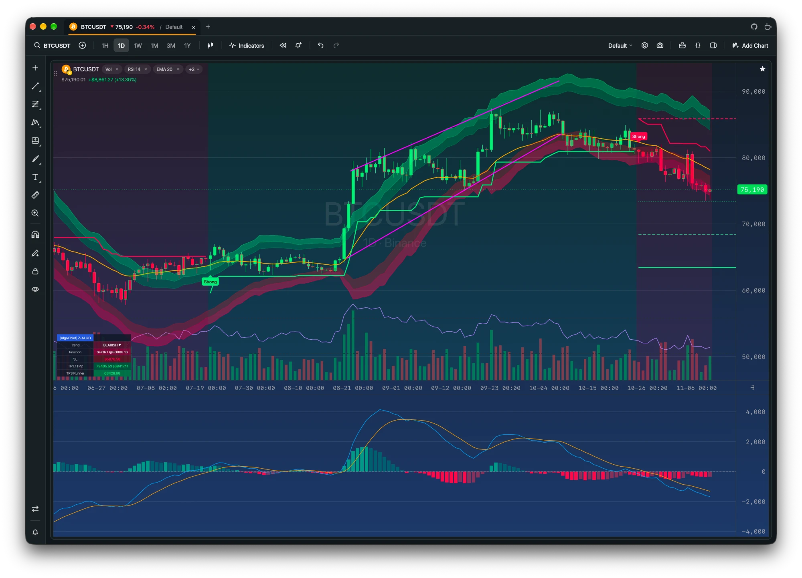
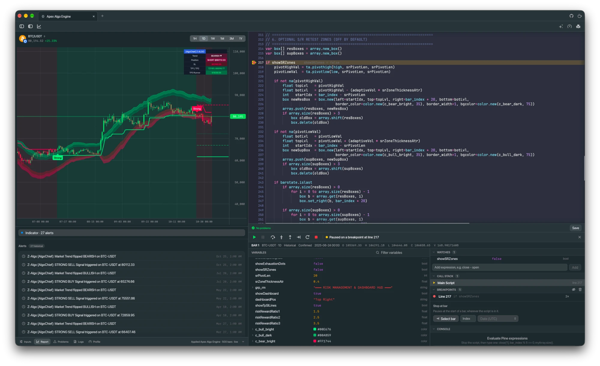
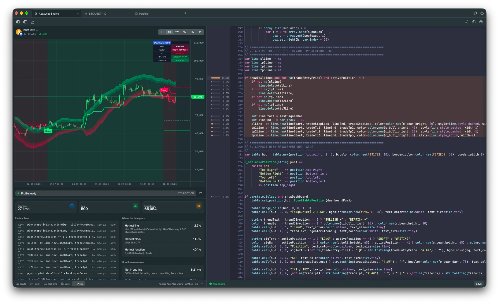

<div align="center">

# DegenView: the free, open source TradingView alternative

Charts for crypto, stocks and prediction markets, with Pine Script v6 that runs on your own machine.
No account. No subscription.

[](https://github.com/degenview/degenview/releases)
[](https://github.com/degenview/degenview/releases)
[](https://github.com/degenview/degenview/stargazers)
[](LICENSE.md)


[Website](https://degenview.app) · [Download](#download) · [Docs](https://docs.degenview.app) · [Compare with TradingView](https://degenview.app/tradingview-alternative/)

<br>



</div>

## Why DegenView

- **Free and open source.** GPL-3.0, no paywalled features.
- **No account.** Install it and start charting.
- **Private.** Your scripts, alerts, watchlists and portfolios stay on your device.
- **Native and fast.** Built in Rust for macOS, Windows and Linux.

## Features

### Markets

- **Crypto** from Binance, Coinbase, OKX, Kraken, Bybit, Gate.io, MEXC, CoinGecko and on-chain DEX pairs, searchable side by side.
- **US stocks and ETFs** through Alpaca. A free key is all you need.
- **Prediction markets** from Polymarket and Kalshi, charted as probabilities.
- **Market-wide gauges** such as Crypto Fear and Greed and Altcoin Season.
- **Live prices** streamed in real time, with watchlists and a quick symbol search on `⌘K` or `Ctrl+K`.

### Charting

- **18 chart types** including Candles, Heikin Ashi, Renko, Kagi, Line Break and Point and Figure.
- **80+ drawing tools**: trend lines, channels, Fibonacci, Gann, chart patterns, Elliott waves, position and forecast tools, notes and more.
- **25+ indicators** with a searchable picker and live previews.
- **Compare** any number of markets on one chart, in percent or log scale.
- **Flexible layouts**: grids of charts, colour-linked tabs, saved layouts and chart templates.
- **Bar replay**: step back in time and trade the market again with no lookahead.
- **Screenshot Studio** for sharp chart images you can copy, save or share.

### Pine Script

Write TradingView-style Pine Script v6 and run it locally. Nothing is uploaded.

- **Pine Studio** with a script library, a smart editor and a live preview chart.
- **Step debugger** and **profiler** to find bugs and slow lines fast.
- **20 bundled Pine indicators** such as Ichimoku Cloud, MACD, VWAP and Stochastic.
- **Vibe-code your indicators.** Describe what you want in plain English and the AI assistant writes, compiles and fixes the script for you, using your own API key.
- **Editor themes** to match your taste.

| Step debugger | Profiler |
| :---: | :---: |
|  |  |

### Alerts

- **Price alerts** that cross above or below a level, once or repeating.
- **Pine alerts** fired by your own scripts.
- **Notifications** in the app and on your desktop, plus **webhooks** to reach other tools.
- **Background alerts on macOS**, even after you quit the app.

### Trading and portfolio

- **Paper trading** with market, limit and stop orders, shown right on the chart.
- **Portfolios** with a transaction ledger, profit and loss, allocation and history.
- **Multiple currencies**: USD, EUR, GBP, JPY, CHF and BTC.
- **CSV import and export**, including CoinMarketCap exports.

### MCP server

Let an AI assistant or automation tool work with DegenView through the [Model Context Protocol](https://modelcontextprotocol.io).

- **Read** charts, candles, indicator values, quotes, watchlists and portfolios.
- **Change** charts, timeframes, indicators, drawings and watchlists.
- **Vibe-code from your own AI tool**: write Pine scripts, check them and put them on a chart.
- **Manage** price alerts and paper trades.
- **Stay in control**: off by default, local only and permission based. Deletes and orders wait for your approval in the app.

### Extras

- **Session statistics** that show how often gaps fill, prior-day levels break and weekdays behave, with sample sizes.
- **Light and dark themes**, and sessions that come back as you left them.

## Download

Get the latest build from the [releases page](https://github.com/degenview/degenview/releases) or pick your platform.

| Platform | Install |
| --- | --- |
| **macOS** (Apple Silicon and Intel) | Open the `.dmg` and drag DegenView to Applications, or use Homebrew |
| **Windows** (x64 and ARM64) | Run the `-setup.exe`, or unzip the portable `.zip` |
| **Linux** (x64 and arm64) | Use the `.tar.gz` or the Flatpak bundle |

DegenView updates itself from inside the app.

<details>
<summary>Homebrew</summary>

```bash
brew install --cask degenview/degenview/degenview      # latest final release
brew install --cask degenview/degenview/degenview@rc   # latest release candidate
```

</details>

<details>
<summary>Linux notes</summary>

Unpack the tarball and add a launcher and icon:

```bash
install -Dm755 degenview "$HOME/.local/bin/degenview"
install -Dm644 degenview.png "$HOME/.local/share/icons/hicolor/512x512/apps/degenview.png"
install -Dm644 degenview.desktop "$HOME/.local/share/applications/degenview.desktop"
```

Or install the sandboxed Flatpak:

```bash
flatpak install --user DegenView-<tag>-linux-<x64|arm64>.flatpak
flatpak run es.nico.degenview
```

Flatpak bundles do not update themselves, so download the next one from the releases page.
Linux needs glibc 2.35 or newer. On an older distro, use the Flatpak.

</details>

<details>
<summary>Windows notes</summary>

The installer needs no admin rights and keeps your data when you remove it. It is not signed yet,
so SmartScreen may ask you to approve the first launch.

</details>

Want to build it yourself? See [BUILDING.md](BUILDING.md).

## Learn more

- [User guide](https://docs.degenview.app) for markets, charts, Pine Studio, alerts and more
- [BUILDING.md](BUILDING.md) to build from source and package a release
- [Architecture](docs/architecture.md) for contributors

DegenView is an independent project and is not affiliated with TradingView.

## Star History

<a href="https://www.star-history.com/?repos=degenview%2Fdegenview&type=date&legend=top-right">
 <picture>
   <source media="(prefers-color-scheme: dark)" srcset="https://api.star-history.com/chart?repos=degenview/degenview&type=date&theme=dark&legend=bottom-right" />
   <source media="(prefers-color-scheme: light)" srcset="https://api.star-history.com/chart?repos=degenview/degenview&type=date&legend=bottom-right" />
   
 </picture>
</a>

## License

DegenView is licensed under the [GNU General Public License v3.0 only](LICENSE.md) (`GPL-3.0-only`).
The fonts built into the app keep their own licences, see [Licensing](docs/licensing.md).
